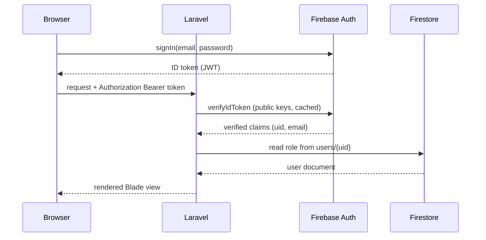

# Firebase setup

The application uses two Firebase products:

- **Firebase Authentication** - users sign in in the browser with the Firebase JavaScript SDK.
  The resulting ID token is sent to Laravel, which verifies it with the Firebase Admin SDK
  (`kreait/firebase-php`).
- **Cloud Firestore** - stores the `users`, `equipments` and `borrowRequests` collections. Laravel
  reads and writes them through `google/cloud-firestore`.



## 1. Create the Firebase project (once per team)

1. Go to <https://console.firebase.google.com> and click **Add project**.
2. Name it `cse3caps-equipment-borrowing` (or reuse the existing team project) and disable
   Google Analytics - it is not needed.
3. In **Build -> Authentication -> Get started**, enable the **Email/Password** provider. Enable
   **Google** as well if social sign-in is required.
4. In **Build -> Firestore Database -> Create database**, choose **Start in production mode** and
   the `australia-southeast1` region.

## 2. Register the web app (values for the frontend)

1. In **Project settings -> General -> Your apps**, click the web icon (`</>`).
2. Register the app with the nickname `CSE3CAPS Web`.
3. Copy the `firebaseConfig` values into your `.env`:

```env
FIREBASE_PROJECT_ID=your-project-id
FIREBASE_API_KEY=AIza...
FIREBASE_AUTH_DOMAIN=your-project-id.firebaseapp.com
FIREBASE_STORAGE_BUCKET=your-project-id.appspot.com
FIREBASE_MESSAGING_SENDER_ID=1234567890
FIREBASE_APP_ID=1:1234567890:web:abcdef
```

These six values are **public by design** - they are shipped to the browser by the JavaScript
SDK. Access is controlled by Firebase security rules, not by hiding the API key.

## 3. Create the service account key (value for the backend)

1. Go to **Project settings -> Service accounts**.
2. Click **Generate new private key** and confirm. A JSON file is downloaded.
3. Save it in the project as:

```
storage/app/firebase/service-account.json
```

4. Confirm it is ignored by git:

```powershell
git check-ignore -v storage/app/firebase/service-account.json
```

The command must print a matching `.gitignore` rule. **This file grants full administrative
access to the Firebase project - never commit it, never paste it into chat, never attach it to a
report.** If it leaks, revoke the key in the service accounts page and generate a new one.

5. Point the backend at the file in `.env`:

```env
FIREBASE_CREDENTIALS=storage/app/firebase/service-account.json
```

## 4. Verify the connection

```powershell
php artisan firestore:init
```

The command creates the three collections with their schema documents and reads one back. It is
idempotent, so it is safe to run more than once.

You can also open <http://127.0.0.1:8000/_health/firebase> while `php artisan serve` is running.
That route is only registered in the `local` environment and reports whether the Admin SDK and
Firestore are reachable.

## 5. Security rules

The initial rules deny all direct client access, because every read and write goes through the
Laravel backend using the service account. Paste the following into
**Firestore Database -> Rules**:

```
rules_version = '2';
service cloud.firestore {
  match /databases/{database}/documents {
    match /{document=**} {
      allow read, write: if false;
    }
  }
}
```

If Person A later needs to read the catalog directly from the browser, relax the rule for the
`equipments` collection only:

```
match /equipments/{equipmentId} {
  allow read: if request.auth != null;
  allow write: if false;
}
```

## Troubleshooting

| Error | Cause | Fix |
| --- | --- | --- |
| `Unable to load the Firebase credentials` | `FIREBASE_CREDENTIALS` path is wrong or the file is missing | Check the path is relative to the project root and the file exists |
| `The caller does not have permission` | Wrong project, or Firestore not created yet | Confirm `FIREBASE_PROJECT_ID` matches the JSON key's `project_id` |
| `Class "Google\Cloud\Firestore\FirestoreClient" not found` | Dependencies not installed | `composer install` |
| `could not load the grpc extension` | `grpc` not enabled in `php.ini` | See [php-grpc-windows.md](php-grpc-windows.md) |
| `Firebase ID token has expired` | Frontend cached an old token | Call `getIdToken(true)` in the browser to force a refresh |
