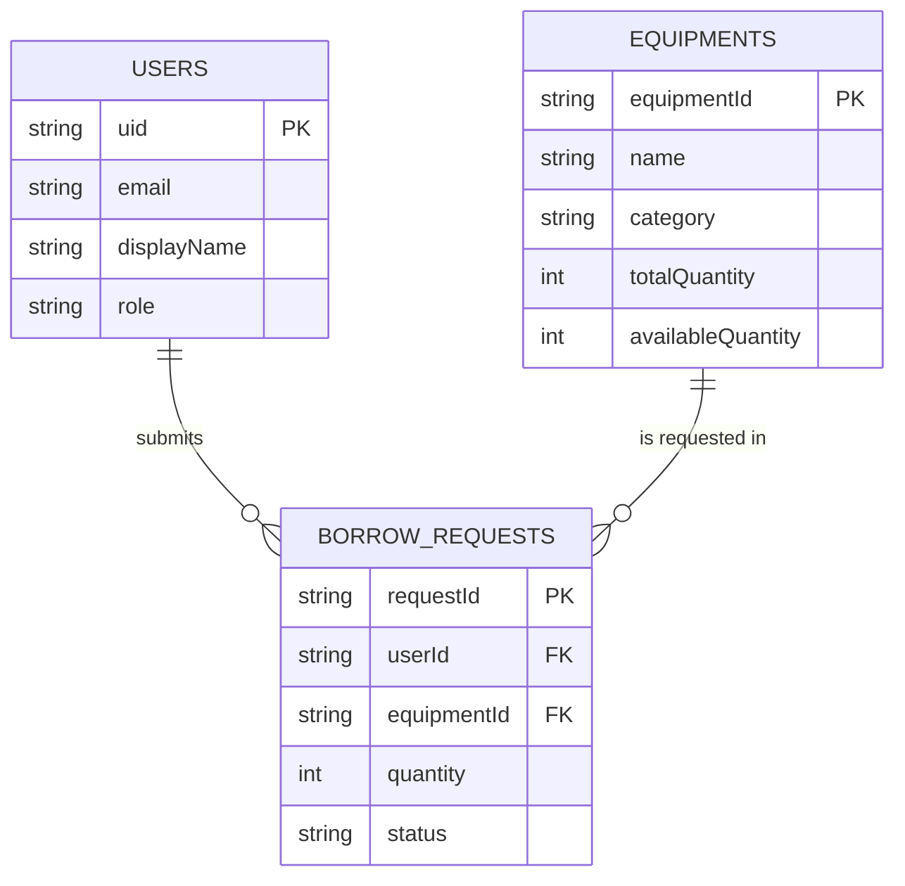
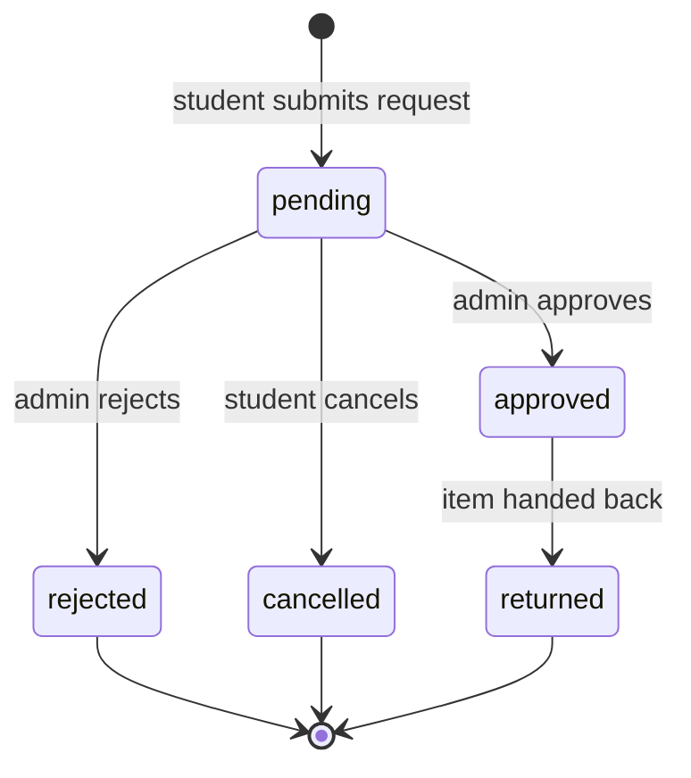

# Firestore schema

Reference for the three top-level collections used by the Equipment Borrowing System. Run
`php artisan firestore:init` to create the collections and their schema documents.

Firestore is schemaless, so this document is the contract: every write from Laravel must use
exactly these field names and types.



## Conventions

- Collection names are lowercase plural: `users`, `equipments`, `borrowRequests`.
- Field names are `camelCase`.
- `createdAt` and `updatedAt` are Firestore **timestamps**, written with
  `FieldValue::serverTimestamp()` so the server clock is authoritative.
- Enum-like fields store lowercase strings and are validated in Laravel, not in Firestore.
- Documents whose id is `_schema` are placeholders created by `firestore:init`. They document the
  shape of the collection and are ignored by application queries (`isSchema == true`).

## `users`

Document id: the Firebase Authentication **uid**, so a user document can be fetched directly from
a verified ID token without a query.

| Field | Type | Required | Notes |
| --- | --- | --- | --- |
| `uid` | string | yes | Same value as the document id |
| `email` | string | yes | From the Firebase ID token |
| `displayName` | string | yes | Falls back to the part of the email before `@` |
| `role` | string | yes | `admin` or `user`. Default `user`; only an admin may change it |
| `studentId` | string | no | La Trobe student number |
| `photoUrl` | string | no | Avatar from the Google provider |
| `disabled` | boolean | yes | `true` blocks the account from borrowing |
| `createdAt` | timestamp | yes | Server timestamp |
| `updatedAt` | timestamp | yes | Server timestamp |

```json
{
  "uid": "8fJ2kQ...",
  "email": "21999999@students.latrobe.edu.au",
  "displayName": "Person B",
  "role": "user",
  "studentId": "21999999",
  "photoUrl": null,
  "disabled": false,
  "createdAt": "2026-08-16T04:00:00Z",
  "updatedAt": "2026-08-16T04:00:00Z"
}
```

## `equipments`

Document id: auto-generated Firestore id.

| Field | Type | Required | Notes |
| --- | --- | --- | --- |
| `name` | string | yes | Display name, e.g. `Canon EOS R50` |
| `category` | string | yes | `camera`, `laptop`, `audio`, `cable`, `other` |
| `description` | string | no | Shown on the catalog detail view |
| `imageUrl` | string | no | Public image URL |
| `location` | string | no | Storage room or campus |
| `totalQuantity` | integer | yes | Units owned, `>= 0` |
| `availableQuantity` | integer | yes | Units free to borrow, `0 <= value <= totalQuantity` |
| `status` | string | yes | `available` or `unavailable` (manual override, e.g. maintenance) |
| `createdAt` | timestamp | yes | Server timestamp |
| `updatedAt` | timestamp | yes | Server timestamp |

```json
{
  "name": "Canon EOS R50 Camera Kit",
  "category": "camera",
  "description": "24MP mirrorless body with 18-45mm lens, battery and charger.",
  "imageUrl": "https://example.com/images/eos-r50.jpg",
  "location": "Beth Gleeson, Room 210",
  "totalQuantity": 4,
  "availableQuantity": 4,
  "status": "available",
  "createdAt": "2026-08-16T04:00:00Z",
  "updatedAt": "2026-08-16T04:00:00Z"
}
```

`availableQuantity` is decremented when a request is approved and incremented when the item is
returned. Do this inside a Firestore transaction so two approvals cannot oversell the same unit.

## `borrowRequests`

Document id: auto-generated Firestore id.

| Field | Type | Required | Notes |
| --- | --- | --- | --- |
| `userId` | string | yes | Firebase uid of the borrower (`users` document id) |
| `userEmail` | string | yes | Denormalised so admin lists need no extra read |
| `equipmentId` | string | yes | `equipments` document id |
| `equipmentName` | string | yes | Denormalised for the same reason |
| `quantity` | integer | yes | `>= 1`, must not exceed `availableQuantity` |
| `borrowFrom` | timestamp | yes | Start of the borrowing period |
| `borrowTo` | timestamp | yes | End of the borrowing period, after `borrowFrom` |
| `purpose` | string | yes | Free text from the request form |
| `status` | string | yes | `pending`, `approved`, `rejected`, `returned`, `cancelled` |
| `reviewedBy` | string | no | Firebase uid of the admin who decided |
| `reviewedAt` | timestamp | no | When the decision was made |
| `reviewNote` | string | no | Reason, especially for a rejection |
| `returnedAt` | timestamp | no | When the item came back |
| `createdAt` | timestamp | yes | Server timestamp |
| `updatedAt` | timestamp | yes | Server timestamp |

```json
{
  "userId": "8fJ2kQ...",
  "userEmail": "21999999@students.latrobe.edu.au",
  "equipmentId": "Hs82kdLpQ...",
  "equipmentName": "Canon EOS R50 Camera Kit",
  "quantity": 1,
  "borrowFrom": "2026-08-20T09:00:00Z",
  "borrowTo": "2026-08-27T17:00:00Z",
  "purpose": "Filming the capstone demonstration video.",
  "status": "pending",
  "reviewedBy": null,
  "reviewedAt": null,
  "reviewNote": null,
  "returnedAt": null,
  "createdAt": "2026-08-16T04:00:00Z",
  "updatedAt": "2026-08-16T04:00:00Z"
}
```

### Status transitions



## Indexes

Single-field indexes are created automatically. The following composite indexes are needed once
the Sprint 3 listing screens exist; create them in
**Firestore Database -> Indexes -> Composite**, or click the link in the exception message that
Firestore returns.

| Collection | Fields | Used by |
| --- | --- | --- |
| `borrowRequests` | `userId` asc, `createdAt` desc | "My requests" list for a student |
| `borrowRequests` | `status` asc, `createdAt` desc | Admin queue of pending requests |
| `equipments` | `category` asc, `name` asc | Filtered catalog browsing |

## Security rules

All access goes through Laravel with the service account, which bypasses security rules, so the
client-facing rules deny everything by default. See
[firebase-setup.md](firebase-setup.md#6-security-rules).
